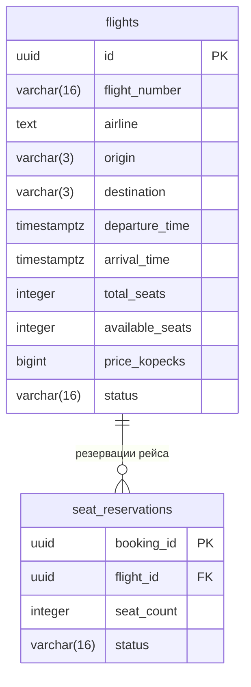
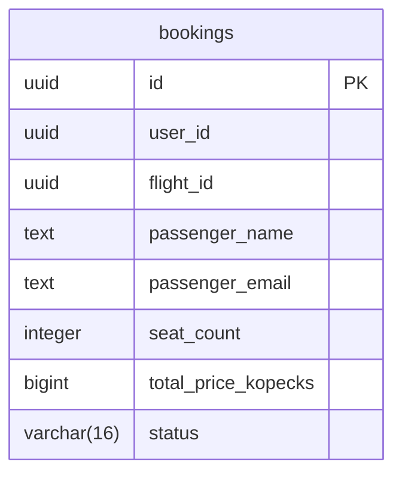

# Схема данных

Booking Service принимает REST-запросы и обращается к Flight Service по gRPC.
У каждого сервиса своя PostgreSQL. Схема соответствует начальным миграциям
в `services/booking/migrations/` и `services/flight/migrations/`.

## Flight DB

Один рейс может иметь несколько резерваций или не иметь их совсем.
Каждая резервация относится к одному рейсу.
`seat_reservations.flight_id` — внешний ключ на `flights.id`.

## Booking DB

Связи между двумя БД логические, без внешних ключей:

- `bookings.flight_id` содержит `flights.id`: на один рейс может быть много бронирований.
- `seat_reservations.booking_id` содержит `bookings.id`: успешному бронированию
  соответствует одна резервация. Первичный ключ `booking_id` запрещает дубликаты.
  Наличие соответствующей записи в другой БД обеспечивают сервисы через gRPC.

Все поля обязательны (`NOT NULL`). `PK` обозначает первичный ключ,
`FK` — внешний ключ внутри одной БД. Пользователи относятся к внешней системе:
здесь хранится только `user_id`, отдельная таблица пользователей не нужна.

## Ограничения

| Таблица | Ограничения |
| --- | --- |
| flights | `total_seats > 0`, `0 <= available_seats <= total_seats`, `price_kopecks > 0` |
| flights | `arrival_time > departure_time`; аэропорты различаются, коды состоят из трёх заглавных латинских букв |
| flights | Номер рейса и авиакомпания не пустые; уникальна пара «номер рейса + дата вылета UTC» |
| seat_reservations | `seat_count > 0`; `booking_id` уникален как первичный ключ |
| bookings | `seat_count > 0`, `total_price_kopecks > 0`; имя и email пассажира не пустые |

Уникальность рейса задана индексом по `flight_number` и
`(departure_time AT TIME ZONE 'UTC')::date`. Два вылета одного номера
в разное время одного дня не считаются разными рейсами.

Допустимые статусы ограничены `CHECK`:

- Рейс: `SCHEDULED`, `DEPARTED`, `CANCELLED`, `COMPLETED`.
- Резервация: `ACTIVE`, `RELEASED`, `EXPIRED`.
- Бронирование: `CONFIRMED`, `CANCELLED`.

Деньги хранятся целым числом копеек. `total_price_kopecks` фиксируется
при бронировании и не меняется при изменении цены рейса.

## Соответствие 3NF

Поля содержат отдельные значения, списков внутри столбцов нет — это 1NF.
У каждой таблицы простой первичный ключ, поэтому частичных зависимостей
от части ключа нет — это 2NF.

В принятой модели неключевые поля описывают запись, определяемую её ключом,
и не определяют другие неключевые поля. Например, имя и email пассажира —
данные на момент конкретного бронирования, а не справочник пользователей.
В бронировании нет копий маршрута и авиакомпании: они хранятся у рейса.
Так исключаются транзитивные зависимости — это 3NF.

Аэропорты представлены только IATA-кодами, авиакомпания — названием.
Дополнительных сведений о них нет, поэтому отдельные справочники здесь не нужны.
Количество доступных мест хранится по требованию задания и должно обновляться
в одной транзакции с резервацией.
